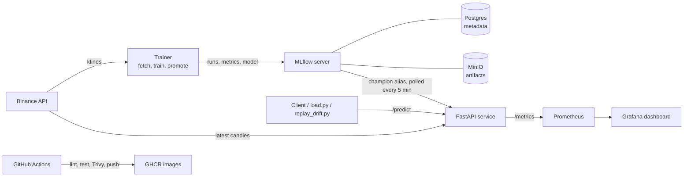

# Crypto Volatility Forecasting: MLOps Pipeline

Forecasts **next-hour volatility of BTCUSDT** from Binance hourly candles, and automates everything around the model: data fetching, training, experiment tracking, a promotion gate, serving, and drift and latency monitoring.

The framing is market risk monitoring, not trading. The model predicts how much the price will move, not which direction it will go. The model itself is kept simple (scikit-learn GradientBoostingRegressor), because the focus is the pipeline.

## What it does

- **Data:** pulls about 1 year of 1h klines from the Binance public API (paginated, with retries) and builds leakage-safe features: returns, rolling volatility, volume, and hour/day.
- **Target:** Parkinson volatility of the next candle, `sqrt(ln(high/low)^2 / (4 ln 2))`.
- **Training:** time-based split (the last 14 days are the test set, no shuffling). Parameters, RMSE/MAE, the model, and the feature reference distributions are logged to MLflow.
- **Promotion gate:** the new model (challenger) and the current `champion` are scored on the same test window. The `champion` alias moves only if the challenger's RMSE is lower.
- **Serving:** FastAPI app. `GET /predict` scores the latest live candles, and `POST /predict` scores a feature payload you send. The app polls MLflow every 5 minutes and hot-swaps a new champion without restarting.
- **Monitoring:** Prometheus metrics (request count, latency histogram, latest prediction, model version, and PSI drift per feature and overall), shown on a Grafana dashboard that is provisioned from files.
- **CI:** GitHub Actions runs ruff and pytest. On `main` it also builds the images, scans them with Trivy (fails on CRITICAL), and pushes them to GHCR tagged with the commit SHA and `latest`.

## Architecture



## How to run

Requirements: Docker Desktop (running, 6 GB+ memory), Python 3.11, [uv](https://docs.astral.sh/uv/).

```bash
git clone https://github.com/ngohainnam/mlops-crypto-volatility.git
cd mlops-crypto-volatility
cp .env.example .env            # then change the passwords

docker compose up -d --build    # postgres, minio, mlflow, api, prometheus, grafana
docker compose run --rm trainer # fetch data, train, and promote to champion if better
docker compose restart api      # first run only: the API picks up the new champion now instead of at the next 5-min poll
curl http://localhost:8000/health
curl http://localhost:8000/predict
```

If `api.binance.com` is blocked in your region, set `BINANCE_BASE_URL=https://data-api.binance.vision` in `.env`.

Generate traffic and a drift demo (run on the host):

```bash
uv sync
uv run python -m scripts.load --interval 3
uv run python -m scripts.replay_drift --start 2024-08-01 --end 2024-08-10
```

Run the tests and lint:

```bash
uv run ruff check .
uv run pytest -q
```

Stop the stack with `docker compose stop`. Use `docker compose down -v` only if you want to wipe all runs and models.

| URL | Service |
|---|---|
| http://localhost:8000/docs | Prediction API (Swagger UI) |
| http://localhost:5000 | MLflow: runs, and the `champion` alias under Models |
| http://localhost:9090 | Prometheus |
| http://localhost:3000 | Grafana (`admin` / `GF_SECURITY_ADMIN_PASSWORD`) |
| http://localhost:9001 | MinIO console |

## API

| Endpoint | Description |
|---|---|
| `GET /health` | Status and the loaded model version |
| `GET /predict` | `{symbol, predicted_volatility, model_version, timestamp}` from live candles |
| `POST /predict` | Same output, for a feature payload you send (used in tests and drift replay) |
| `GET /metrics` | `prediction_requests_total`, `prediction_latency_seconds`, `predicted_volatility`, `feature_drift_psi`, `model_version_info` |

PSI guide: below 0.1 is stable, 0.1 to 0.2 is moderate, and above 0.2 is significant drift.

## Stage B: coming next

- **Kubernetes:** a local kind cluster, with Helm charts for the API and MLflow.
- **GitOps:** ArgoCD pulls Helm changes from Git. CI bumps the image tag in `values.yaml`, so no `kubectl apply` is needed.
- **Retraining:** a weekly Kubernetes CronJob (fetch, train, promote), which can also be triggered manually.
- **Alerting:** kube-prometheus-stack, with Alertmanager sending drift (PSI above 0.2), latency (p95 above 500 ms) and API-down alerts to Discord.
- **Failure drills:** reject a worse model, have Trivy block a vulnerable image, recover from a deleted pod, and fire a drift alert.
- **Demo video:** push → CI → ArgoCD sync → predict → drift → alert → retrain → hot-swap.
